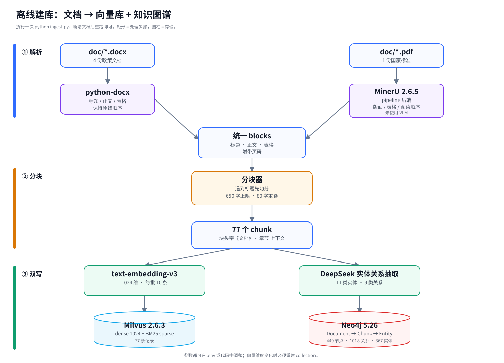
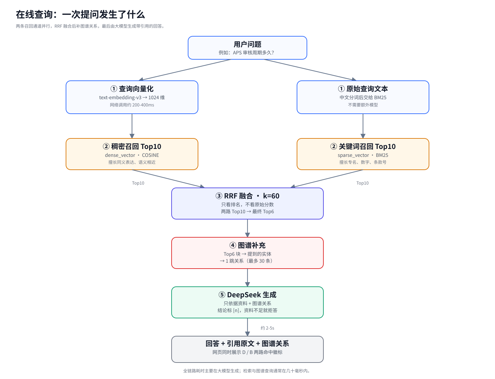

# 技术链路说明

面向“有代码基础、但没接触过 RAG / 知识图谱”的读者。按数据流顺序讲：解析 → 分块 → 向量化 → 存储 → 检索 → 图谱 → 问答。

## 0. 两条链路

实际只有两条链路：**离线建库**只在文档变化时跑，**在线查询**每次提问都跑。

### 0.1 离线建库（`python ingest.py`）



一句话：DOCX 和 PDF 先统一成 blocks，再按标题和 650 字上限切块；同一批 chunk 分别做向量化写入 Milvus、做实体关系抽取写入 Neo4j。

| 阶段 | 输入 | 做什么 | 输出 |
|---|---|---|---|
| ① 解析 | `doc/*.docx`、`doc/*.pdf` | DOCX 用 python-docx 保序读取；PDF 用 MinerU pipeline 保留版面、表格、阅读顺序 | 统一 blocks（标题/正文/表格 + 页码） |
| ② 分块 | blocks | 遇标题先切，正文 650 字上限，句末断开，80 字重叠，块头拼文档与章节 | 77 个 chunk |
| ③ 双写 | chunks | text-embedding-v3 生成 1024 维向量；DeepSeek 抽实体关系 | Milvus（dense + BM25）、Neo4j（449 节点） |

### 0.2 在线查询（每次提问）



一句话：查询同时走语义和关键词两路，各取 Top10 后用 RRF 融合成 Top6，补上图谱一跳关系，最后让大模型只依据这些材料生成带引用的回答。

| 步骤 | 组件 | 关键参数 | 输出 |
|---|---|---|---|
| ① 双通道 | text-embedding-v3 / 原文 | 1024 维；中文分词 | 查询向量、BM25 查询 |
| ② 召回 | Milvus | dense Top10、BM25 Top10 | 两路候选块 |
| ③ 融合 | RRF | k=60 | 最终 Top6 |
| ④ 图谱 | Neo4j | 命中块实体、1 跳、最多 30 条 | 结构化关系 |
| ⑤ 生成 | DeepSeek | 只依据资料、结论标 `[n]` | 回答 + 引用 |

> 网页上还会单独查 dense / sparse 各 Top5，用来显示 `D` / `B` 命中徽标；不影响融合结果。

## 1. 运行拓扑

| 组件 | 端口 | 作用 |
|---|---|---|
| etcd | 2379（容器内） | Milvus 的元数据 |
| MinIO | 9000 / 9001 | Milvus 的对象存储 |
| Milvus 2.6.3 | 19530 / 9091 | 向量库，稠密 + 稀疏 |
| Neo4j 5.26 | 7474 / 7687 | 知识图谱 |
| FastAPI | 8000 | 检索 / 问答 / 图谱接口与网页 |

Milvus standalone 必须依赖 etcd 和 MinIO，所以 compose 里是四个服务。编排见 [`docker-compose.yml`](../docker-compose.yml)。

## 2. 文档解析

### 2.1 DOCX：python-docx

代码：[`parser.py`](../parser.py) 的 `parse_docx`。

- 按 `document.element.body` 的原始顺序遍历段落和表格，避免“先读所有段落、再读所有表格”导致顺序错乱。
- 标题识别有两种：
  1. Word 样式名包含 `Heading` / `标题`；
  2. 中文编号正则：`一、`、`1.`、`1.1`、`第X章`。
- 表格按行拼成 `单元格 | 单元格` 的文本。
- 统一输出 block：

```json
{"type": "title|text|table", "text": "...", "level": 1, "page": 0}
```

没有用 MinerU 解析 DOCX：MinerU 的 Office 支持依赖 LibreOffice 转换，Windows 上额外装一套环境不划算；DOCX 本身是结构化 XML，python-docx 更准也更轻。

### 2.2 PDF：MinerU 2.6.5

代码：[`parser.py`](../parser.py) 的 `parse_pdf` / `_run_mineru`。

实际执行：

```powershell
.venv-mineru\Scripts\mineru.exe -p doc\GBT+20801.1-2020.pdf -o data\parsed\mineru\... -b pipeline -m auto
```

- `-b pipeline`：使用 MinerU 的 pipeline 后端（非 VLM）。
- `-m auto`：由 MinerU 判断用文本层抽取还是 OCR。本 PDF 是文字版，仅少量识别噪声。
- 优先读取 `*_content_list.json`，取文本、表格和页码；标题在 content_list 里记为 `text` + `text_level`，当前还没有映射成 chunk 的章节字段，所以 PDF 块的 section 为空（可优化点）。
- 逐页对照预览：[mineru-preview.html](mineru-preview.html)，左侧原页、右侧版面检测框、下方解析文本。
- 任意 PDF 都可以用 [`preview_pdf.py`](../preview_pdf.py) 生成同样的预览，不写 Milvus / Neo4j：`python preview_pdf.py doc\xxx.pdf`。
- 结果缓存到 `data/parsed/docs.json`，`python ingest.py --parse` 才会重跑。

本次 PDF 解析结果：8 页、111 个 block、5918 字。

### 2.3 MinerU 到底用了什么模型？VLM 用了吗？

**没有用 VLM，也没有下载 VLM 模型。**

`mineru.json` 当前状态：

```json
{
  "models-dir": {
    "pipeline": "data/.cache/modelscope/.../PDF-Extract-Kit-1.0/snapshots/master",
    "vlm": ""
  }
}
```

已下载的是 PDF-Extract-Kit 的 **pipeline 模型**（约 3.3GB）：

| 目录 | 大小 | 作用 |
|---|---|---|
| Layout | 38 MB | DocLayout-YOLO 版面检测：标题、正文、表格、图片 |
| MFD | 334 MB | 公式检测（YOLO v8） |
| MFR | 1367 MB | 公式识别（UniMERNet） |
| OCR | 882 MB | PaddleOCR 文字识别 |
| OriCls | 6 MB | 页面方向分类 |
| ReadingOrder | 680 MB | layoutreader 阅读顺序 |
| TabCls | 6 MB | 表格分类 |
| TabRec | 15 MB | 表格结构识别 |

为什么先用 pipeline 而不是 VLM：

1. 4.x 的 VLM 后端需要本地 parse-server（`mineru server start`）或 vLLM/LMDeploy，Windows 上不稳；
2. 当前只解析一份文字版 PDF，pipeline 的版面 + OCR + 表格能力已经够；
3. VLM 更适合扫描件、手写、复杂图表、多栏混排，代价是模型更大、更慢。

以后要试 VLM，可以装 `mineru[torch]` 的 VLM 模型并改用 `-b vlm-transformers`，但要接受更慢的速度；`vlm-vllm-engine` 基本只适合 Linux。

另外：MinerU 当前跑在 **CPU** 上（装的是 `torch 2.14.1+cpu`）。这份 PDF 很小，CPU 解析可接受；如果 PDF 多、页数大，可以换 cu128 的 torch 走 GPU。

### 2.4 解析踩过的坑

- MinerU 4.0.12 的 CLI 改成了客户端模式，必须 `mineru server start`，且默认没有可用解析引擎；
- 4.x 会往 `~/.mineru` 写文档库锁文件，沙箱环境会拦截；
- 因此退回 2.6.5 的经典 `-p/-o/-b pipeline` 模式，并把模型缓存、YOLO 配置、matplotlib 缓存全部改到 `data/.cache` 下。

## 3. 分块：不是固定范围

代码：[`chunker.py`](../chunker.py)。

规则是“结构优先 + 长度上限”：

1. 遇到标题就先 flush 当前块，并更新 `section`；
2. 正文累积到约 **650 字** 就切；
3. 切的时候优先在 `。；！？\n` 处断开，避免句子被切一半；
4. 相邻块有 **80 字重叠**，减少边界信息丢失；
5. 每块开头加上下文：

```
《德国留学政策指南》 · 1. 公立大学学费政策（2026年最新）
免学费州（14个州）：
...
```

为什么要加“文档 + 章节”前缀：向量模型和 BM25 都能看到章节语义，引用时也能直接定位。

实测结果（77 块）：

| 指标 | 值 |
|---|---|
| 平均长度 | 347.6 字 |
| 中位数 | 304 字 |
| 最短 | 34 字 |
| 最长 | 682 字 |

长度远小于 650，是因为很多块在标题处提前 flush。这是“结构优先”的代价：块更纯，但会出现很短的块。

当前没有做语义分块、父子块、按表格/条款专门切分。优化方向见第 10 节。

## 4. Embedding：怎么把文字变成向量

代码：[`embedding.py`](../embedding.py)。

- 模型：阿里云百炼 `text-embedding-v3`，OpenAI 兼容接口；
- 维度：1024；
- 批量：每批 10 条（接口限制），按顺序回填；
- 预处理：换行替换成空格，空串替换成空格；
- 失败重试：最多 3 次，指数退避；
- 相似度：Milvus 用 `COSINE`。

它只对 chunk 文本做 embedding，不单独对标题做向量。标题已经拼进 chunk 文本里，所以“章节语义”会被一起编码。

换模型要注意：**维度变了必须重建 collection**，否则插入直接报错；不同模型的向量空间不可混用。

## 5. Milvus：存什么、建什么索引

代码：[`milvus_store.py`](../milvus_store.py) 的 `_create_collection`。

Collection：`kb_chunks`

| 字段 | 类型 | 说明 |
|---|---|---|
| id | INT64 | 主键，自动生成 |
| text | VARCHAR(8192) | 原文块，开启 `chinese` analyzer |
| doc_id | VARCHAR(128) | 文档 ID |
| doc_title | VARCHAR(512) | 文档标题 |
| chunk_id | VARCHAR(128) | 稳定块 ID，如 `德国留学政策指南::003` |
| chunk_index | INT64 | 块序号 |
| dense_vector | FLOAT_VECTOR(1024) | text-embedding-v3 |
| sparse_vector | SPARSE_FLOAT_VECTOR | BM25 输出，不用自己写 |

两个索引：

- `dense_vector`：`AUTOINDEX` + `COSINE`
- `sparse_vector`：`SPARSE_INVERTED_INDEX` + `BM25`

关键设计：`sparse_vector` 不是我们算的，是在 schema 里挂了一个 BM25 Function：

```python
schema.add_function(Function(
    name="text_bm25",
    function_type=FunctionType.BM25,
    input_field_names=["text"],
    output_field_names=["sparse_vector"],
))
```

插入时只给 `text` 和 `dense_vector`，Milvus 自动分词、统计词频并生成稀疏向量。中文分词靠 `text` 字段的 `analyzer_params={"type": "chinese"}`。

> 踩坑：BM25 查询必须打在 `sparse_vector` 字段上，`data` 仍传原始查询文本。打在 `text` 字段会报 `field (text) to search is not of vector data type`（Milvus error 1100）。

## 6. 混合检索：两路召回 + RRF

代码：[`milvus_store.py`](../milvus_store.py) 的 `hybrid_search`。

一次查询同时发两个 `AnnSearchRequest`：

| 通道 | 字段 | 数据 | TopK | 擅长 |
|---|---|---|---|---|
| Dense | dense_vector | 查询的 1024 维向量 | 10 | 语义近义、换一种说法 |
| Sparse | sparse_vector | 原始查询文本 | 10 | 专有名词、数字、条款号、精确匹配 |

然后用 RRF 融合。公式：

```
RRF(d) = Σ_i  1 / (k + rank_i(d))     k = 60
```

举例：某块在向量通道排第 1、BM25 通道排第 1，得分 `1/61 + 1/61 ≈ 0.0328`；只在单通道排第 5，得分 `1/65 ≈ 0.0154`。所以“两路都命中”的块会明显靠前。

为什么用 RRF 而不是加权求和：

- 向量相似度（0~1）和 BM25 分数（可能 0~30）量纲不同，直接加权要归一化、调权重；
- RRF 只看排名，不看原始分数，天然可比、鲁棒；
- 代价是丢掉“分数差距”的信息，极端情况下不如调好的加权融合。

实测：查询“巴登-符腾堡州非欧盟学生学费多少”，两路 Top3 都命中德国政策文档；查询“GB/T 20801.1 适用范围”，BM25 把带条款号的块排到前面，向量通道补语义相关块，融合后两类都在前 4。

网页上每条结果有两个徽标：`D` = 向量 Top5 命中，`B` = BM25 Top5 命中。为了展示这个，接口额外单独跑了 dense 和 sparse 各 Top5。

## 7. 知识图谱

代码：[`extractor.py`](../extractor.py)、[`kg.py`](../kg.py)。

### 7.1 图里有什么

节点：

- `Document`：doc_id、标题、来源、类型
- `Chunk`：chunk_id、序号、章节、预览
- `Entity`：name、type、唯一键 `name::type`

关系：

```
(Document)-[:HAS_CHUNK]->(Chunk)
(Chunk)-[:MENTIONS]->(Entity)
(Entity)-[:LOCATED_IN | OFFERS | REQUIRES | CHARGES | PROVIDES
        | PART_OF | APPLIES_TO | ELIGIBLE_FOR | RELATED_TO]->(Entity)
```

实体类型限定 11 种：Country、Region、University、Program、Degree、Exam、Fee、Visa、Requirement、Scholarship、Organization。

### 7.2 怎么抽

按 chunk 逐块抽，不按整篇：

1. 把 chunk 文本填进固定 Prompt，要求只输出 JSON；
2. DeepSeek 返回 `entities` 和 `relations`；
3. 代码做白名单校验：类型不合法丢弃，关系两端的名字必须在 entities 里出现过；
4. 按 `name::type` 做 `MERGE`，同名同类型实体自动合并；
5. 关系用白名单拼 Cypher，避免注入；
6. 4 个线程并发，单块失败自动退回规则抽取。

为什么按块：上下文小、噪声少、可以并行、以后增量更新只重跑变化的块。按整篇会让模型忽略细节、输出变长、成本变高。

### 7.3 怎么控制幻觉

- Prompt 明确“只抽取文中明确出现的信息”“关系两端必须是已列出的实体”；
- `temperature=0`；
- 实体类型、关系类型双重白名单；
- 关系两头做存在性校验；
- 抽不出就用规则兜底，不让流程中断。

但要说实话：367 个实体里仍有少量泛化词或错误合并，LLM 抽取不可能 100% 干净。生产环境还需要人工抽检、别名词典、置信度过滤。

### 7.4 为什么 GB/T 20801.1 不抽实体

这是压力管道国家标准，主体是条款：“3.2 术语”“4 设计条件”“a) 最高工作压力 ≥ 0.1MPa”。它的结构是**层级条款**，不是“实体—关系—实体”。强行抽只会得到一堆“管道”“压力”这种无区分度的节点。

所以对 `doc_type == 标准规范` 的文档只建 `Document -> Chunk`，不抽实体。检索仍可用向量 + BM25 命中条款。

### 7.5 检索时图谱怎么用

1. 混合检索得到 Top6 块；
2. 用 `chunk_id` 去 Neo4j 找这些块 `MENTIONS` 的实体；
3. 取这些实体的 1 跳关系（最多 30 条）；
4. 把三元组拼进 Prompt，作为结构化补充；
5. 网页“问答”里会显示“用到的图谱关系”。

### 7.6 什么数据适合知识图谱

适合：

- 实体和关系在原文中反复出现、边界清楚：院校—地区、产品—厂商、法规—适用对象；
- 需要多跳查询：某州的学校 → 某学校的专业 → 该专业的语言要求；
- 需要结构化对比、聚合、路径解释。

不适合：

- 纯叙述、散文、观点类文本；
- 以条款、公式、流程步骤为主的标准/手册；
- 语料极小（本项目的 5 篇就偏小，图谱更多是演示和补充，不是主力）；
- 实体边界模糊、同义词极多且没有词典。

## 8. 问答生成

代码：[`rag.py`](../rag.py)。

Prompt 规则：

1. 只用提供的资料和图谱关系；
2. 关键结论后标 `[n]`；
3. 资料不足就回答“资料中未找到”；
4. 金额、分数、时间必须与资料一致。

如果没有配置 `LLM_API_KEY`，接口不会报错：返回检索结果与引用，`answer` 为空，网页会提示未配置。

## 9. 一次提问的完整时序

```
用户输入
  → embedding.embed_text(query)              ~200-400ms（网络）
  → Milvus dense_search + sparse_search      ~10-30ms
  → Milvus hybrid_search (RRF)               ~10-30ms
  → Neo4j triples_for_chunks                 ~5-20ms
  → DeepSeek chat                            2-5s
  → 返回 answer + citations + triples
```

建库实测：77 块，向量化 + 写 Milvus + 60 块实体抽取，总计约 31 秒。

## 10. 评估与优化

### 10.1 当前做了什么

- 4 组人工查询检查召回：德国学费、APS、新加坡硕士、GB/T 适用范围；
- 浏览器端检查检索、问答、图谱三个页面；
- 没有做量化评估，这是当前最大的短板。

### 10.2 应该怎么补评估

1. 人工构造 30-50 条问题，标注“标准答案块”；
2. 指标：
   - Recall@5 / Recall@10：正确块有没有被召回；
   - MRR：第一个正确块排多前；
   - nDCG@10：排序质量；
   - 引用准确率：回答里的 `[n]` 是否真的支持该结论；
   - 拒答率：资料不足时是否正确说“未找到”。
3. 做消融：只用 dense、只用 BM25、dense+BM25、再加图谱，对比指标；
4. 用 LLM-as-judge 做初筛，再人工抽检 20%。

### 10.3 可优化清单

| 方向 | 具体做法 | 收益 |
|---|---|---|
| 分块 | 语义分块、父子块（小块检索、大块喂模型） | 减少语义被切断 |
| 检索 | 加 BGE / Qwen reranker 精排 Top20→Top6 | 提升排序质量 |
| 查询 | 查询改写、同义词扩展、多查询融合 | 提升召回 |
| 图谱 | 实体别名合并、关系置信度、GraphRAG 社区摘要 | 降低噪声 |
| 工程 | 增量入库、按 doc_id 删除、内容哈希去重 | 支持持续更新 |
| 成本 | 缓存 embedding、异步批处理、本地小模型 | 降延迟和费用 |

## 11. 局限与已知问题

1. 语料只有 5 篇，图谱规模小，统计意义有限；
2. PDF 有少量 OCR 噪声（例如页眉识别成“国家监督理层花”）；
3. 固定 650 字 + 标题优先会产出 34 字的短块；
4. 没有 reranker，Top6 里可能混入弱相关块；
5. 每次 `ingest.py` 全量重建，没有增量更新；
6. 单机单副本，没有权限、限流、监控；
7. `.env` 明文存 key，生产要放密钥管理服务。

## 12. 关键文件与命令

| 文件 | 作用 |
|---|---|
| [`parser.py`](../parser.py) | DOCX / PDF 解析 |
| [`chunker.py`](../chunker.py) | 分块 |
| [`embedding.py`](../embedding.py) | text-embedding-v3 |
| [`milvus_store.py`](../milvus_store.py) | 建表、混合检索 |
| [`extractor.py`](../extractor.py) | 实体关系抽取 |
| [`kg.py`](../kg.py) | Neo4j 读写 |
| [`rag.py`](../rag.py) | 问答 Prompt |
| [`server.py`](../server.py) | FastAPI |
| [`ingest.py`](../ingest.py) | 一键入库 |
| [`preview_pdf.py`](../preview_pdf.py) | 只看 PDF 解析效果，不写数据库 |

```powershell
docker compose up -d
.venv\Scripts\python.exe ingest.py
.venv\Scripts\uvicorn.exe server:app --host 127.0.0.1 --port 8000
```

面试表达和话术见 [`面试问答.md`](面试问答.md)。
